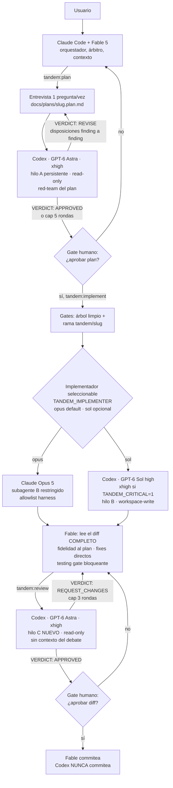

# Arquitectura de tandem

## El esquema



## Regla de hilos

```
Mismo rol, rondas sucesivas  → mismo hilo (el crítico recuerda sus hallazgos)
Cambio de rol                → hilo nuevo (el revisor final llega sin contaminar)
```

- Codex revisa el plan, Fable corrige, Codex re-revisa → **hilo A** siempre.
- Empieza la implementación → **hilo/subagente B** nuevo. Con el default `opus`, es `tandem:implementer` (o `tandem:implementer-critical` con `effort: xhigh` bajo `TANDEM_CRITICAL=1` — desde v0.21, con gate de versión Claude Code ≥ 2.1.111) y sus rondas continúan vía `SendMessage`; con `TANDEM_IMPLEMENTER=sol`, es el hilo Codex CLI existente (Sol, effort high).
- Review final del código → **hilo C** nuevo (Codex), clave de estado `cr-<slug>`.
- El implementador nunca aprueba su propia implementación.

El hilo B Opus tiene espejo durable en `.tandem/state/implement-claude/<slug>.json`: agent id/nombre, rondas consumidas, último sentinel e informe, worktree e identidad del intento (`plan_path`, `plan_hash`, `branch`). `plan_hash` siempre es `git rev-parse HEAD:docs/plans/<slug>.plan.md`, el blob commiteado; nunca la working copy que cambia al marcar checkboxes. Identidad coincidente permite reanudar o un reset deliberado; mismatch solo permite descartar o parar. Ningún reset usa `SendMessage` como sonda ni ocurre sin agente inactivo comprobado y, si está registrado, worktree limpio. Ante incertidumbre autonomous termina `FAILED` preservando el estado.

## Protocolo de conversación entre modelos

Nunca "discutid hasta acordar". Cada ronda es: crítica estructurada (P1/P2 o Critical→Suggestion, con evidencia file:line) → Fable arbitra cada hallazgo (ACCEPTED con el cambio / REJECTED con la razón) → el MISMO hilo re-verifica solo sus hallazgos y lo nuevo. Sentinel machine-parseable en la última línea (`VERDICT: …`, `IMPLEMENTATION_…`). Loops acotados (plan 5, code review 3, continuaciones 2). Deadlock = resultado legítimo que se muestra al usuario con ambas posiciones.

## Transportes actuales y por qué CLI, no MCP (fase 1 → fase 2)

El implementador default usa un subagente Claude `model: opus` con allowlist de harness (`Read, Edit, Write, Glob, Grep, Bash`), sin MCP, web ni Agent anidado. Esa frontera no es un sandbox OS: Bash conserva capacidad residual para ejecutar comandos que la sesión permita. El system prompt y el template prohíben commit/push/cambios de rama o remoto y fijan una única ruta absoluta; Fable compara después rama, `HEAD` y remotos antes del gate. Con `TANDEM_WORKTREE=1`, prompt, verificación y testing gate quedan anclados al cwd absoluto del worktree. Agent no expone effort por llamada, pero el frontmatter del agent type sí (Claude Code ≥ 2.1.111): desde v0.21, `TANDEM_CRITICAL=1` bajo opus selecciona `tandem:implementer-critical` (copia byte a byte del implementer con `effort: xhigh` — paridad fijada por test) con el tipo EFECTIVO persistido en el attempt state (`agent_type`, enum cerrado, recovery mismo-modo, mismatch → consent/FAILED). La review sigue siendo obligatoria; los efforts mostrados son siempre los EFECTIVOS (los overrides `TANDEM_IMPLEMENT_EFFORT` y `CLAUDE_CODE_EFFORT_LEVEL` tienen precedencia y el doctor lo refleja).

### Barreras mecánicas de escritura durante implement

Un intento fresco de `tandem:implement`, en ambos transportes, ejecuta
`scripts/implement-audit.sh snapshot` antes de lanzar. El script guarda bajo
`.tandem/state/implement-audit/` la identidad inmutable del plan commiteado y del
`HEAD`, un censo acotado de directorios `node_modules` y sus nombres de primer nivel,
y publica el guard de vida del intento. `check`, antes del testing gate, compara las
escrituras Git (index y worktree, untracked completos) y el censo contra una deny-list;
un toque no declarado en **Files to touch** del blob commiteado convierte el intento en
PARTIAL. `close` retira el guard solo después de gate y auditoría verdes. El reset borra
censo → estado del intento → guard último; un crash o reset interrumpido conserva el
bloqueo sin caducidad hasta un reset explícito.

El primer hook del plugin, `PreToolUse` sobre `Bash`, usa ese guard para bloquear con
exit 2 los mutadores de npm/pnpm/yarn durante la vida del intento. El match por segmentos
ocurre antes de consultar disco, así que Bash no relacionado no paga la búsqueda de
guards. Son barreras contra bucles accidentales, no defensa adversarial: Opus sin sandbox
de SO todavía podría borrar guard/censo o escribir a mano. También quedan fuera de la
visibilidad las ediciones deny-listed que Git ignore y la mutación de contenido **dentro**
de una entrada de primer nivel ya existente en `node_modules`; el censo detecta cambios
del conjunto de nombres, no un snapshot profundo.

**Fase 1 (esta)**: Codex sigue usándose vía `codex exec` con scripts endurecidos para plan/review/ask y para implementación cuando `TANDEM_IMPLEMENTER=sol`. Verificado contra el código fuente de la CLI (2026-07):

- `codex exec resume` NO define `--sandbox`/`--model` propios; las opciones compartidas van en el padre: `codex exec --sandbox read-only … resume <id> …`. Los scripts además fuerzan `-c sandbox_mode=…` como cinturón y tirantes. Así ninguna reanudación hereda el default del `config.toml` del usuario (el fallo principal de TRIP-workflow).
- Prompt por stdin desde archivo (`- <file`): elimina cuelgues de stdin no-TTY y bugs de quoting a la vez.
- `--output-last-message` por turno con pre-borrado: imposible leer un veredicto rancio de una ronda anterior.
- Eventos y stderr capturados POR TURNO en `.tandem/state/…` (nunca `2>/dev/null`): los fallos de auth/red/modelo son visibles.
- Detección del fallback silencioso de `resume` (un id corrupto puede adjuntarse a otra sesión): si el turno reporta un `thread_id` distinto del pedido, fallo duro.

### Pins de argv: qué NO puede heredar un turno de tandem

Los tres wrappers (`codex-start.sh`, `codex-resume.sh`, `codex-swarm.sh`) llevan el mismo bloque de política en posición fija, generado por un único helper (`codex_pins()` en `scripts/_pins.sh`, sourceado por `_common.sh` y también por `codex-doctor.sh --smoke`) y congelado byte a byte por la suite:

| Pin | Por qué |
| --- | --- |
| `--ignore-user-config` | Pinear claves una a una nunca cubre lo que no se enumera: servidores MCP con capacidad de red, claves futuras. Ignorar el `config.toml` del usuario elimina la clase entera; el login sobrevive porque auth usa `CODEX_HOME` |
| `--ignore-rules` | Lo mismo para los ficheros execpolicy `.rules` de usuario o proyecto |
| `-c sandbox_mode=<sandbox>` | Cinturón del `--sandbox`, ahora en los tres scripts y no solo en resume |
| `-c sandbox_workspace_write.network_access=false` | Los comandos del sandbox se quedan sin red |
| `-c sandbox_workspace_write.writable_roots=[]` | `--cd` aporta la raíz primaria, pero los roots configurados se AÑADEN: sin este pin, un `writable_roots` heredado mantiene escribible el checkout principal desde un turno anclado al worktree |
| `-c approval_policy=never -c approvals_reviewer=user` | Con `approvals_reviewer=auto_review` en el config del usuario, un turno headless deja de forzar `never` y las peticiones de escape de sandbox o de red pasan a ser auto-aprobables |
| `-c web_search=disabled` (roles de escritura; todos con `TANDEM_WEB_SEARCH=off`) | `network_access` gobierna la red de los comandos, no la herramienta nativa de búsqueda; sin el pin, `implement.tpl` prometería "sin red" en falso. El interruptor dedicado permite cerrar el mismo canal en los asientos read-only |

Los `-c` **siguen aplicándose y validándose** con `--ignore-user-config` puesto: flag y pins son complementarios, y los pins explícitos quedan como defensa en profundidad y declaración de intención verificable. Coste aceptado y deliberado: la personalización legítima del usuario (modelo por defecto, MCP propios) no llega a los turnos de tandem.

Los roles read-only (`review`, `ask`, y todos los asientos `ultra`) conservan la búsqueda web **sin pin por defecto**, por decisión de gate humano: un asiento que no puede escribir conserva capacidad útil y, con el config del usuario ignorado, su comportamiento pasa a ser el default determinista de la CLI. Residual documentado: un asiento read-only con búsqueda activa podría transmitir contenido del repo en una query; `TANDEM_WEB_SEARCH=off` ofrece el mando para cerrar ese canal en todos los asientos sin cambiar el default.

Los temp roots (`/tmp`, `$TMPDIR`) siguen escribibles a propósito (`exclude_*` en su default `false`): las herramientas los necesitan y no son el árbol del proyecto. Lo que prohíbe escribir fuera de la raíz de trabajo es el lenguaje del prompt, no el sandbox.

### Verificar una clave de config sin gastar cuota

`codex debug prompt-input -c <clave>=<valor> hola` valida la configuración y sale **sin llamar al modelo**. Aviso crítico: una clave *desconocida* se acepta EN SILENCIO con rc 0 (`-c web_search_mode=disabled` no falla — simplemente no hace nada; la clave real es `web_search`). Por eso una clave solo se da por viva cuando **rechaza un valor inválido**, nunca porque acepte el override.

`scripts/config-probe.sh` automatiza justo eso para las cinco claves pineadas, bajo un `CODEX_HOME` temporal y borrado con `trap EXIT` (`debug prompt-input` no acepta `--ignore-user-config`, que es exclusivo de `codex exec`, así que el aislamiento se consigue con un home vacío). Usa `debug prompt-input` y nunca `codex exec`: con `exec`, el caso que el probe existe para detectar — la clave desaparecida — aceptaría el override y arrancaría un turno real. El job `config-drift` lo ejecuta semanalmente contra la CLI pineada y contra `@latest`, que es lo que convierte un rename silencioso en una señal. Ese job va **sin gate de secret** a propósito: el probe no necesita credenciales, y dejarlo dentro del `codex-smoke` gateado significaría que un repo sin `OPENAI_API_KEY` nunca se entera de que un pin dejó de aplicar.

### Raíz de trabajo: ejecución en el worktree, estado en el principal

`TANDEM_CODEX_CWD` (opcional) fija el directorio del turno vía `codex exec --cd`, como un único token y sin normalización propia. `CLAUDE_PROJECT_DIR` **no** se reapunta: el estado de hilos y el heartbeat siguen bajo el checkout principal, así que `codex-show`/`codex-reset` funcionan desde ahí y borrar el worktree no destruye el hilo — se recrea y el mismo hilo reanuda.

`scripts/worktree-root.sh <slug>` es quien resuelve esa raíz y lo que ambas skills invocan: sin `TANDEM_WORKTREE=1` imprime el checkout principal; con él, la ruta del worktree **registrado** para `refs/heads/tandem/<slug>` leída de `git worktree list` — no la convención `.worktrees/<slug>`, que un worktree reutilizado en otra ruta rompería. Cero coincidencias, varias, o una ruta registrada ausente del disco son error duro (65): jamás un fallback silencioso al principal. `TANDEM_WORKTREE` gobierna **la aprobación del plan e implement/review**: desde 0.12, `scripts/plan-approve.sh` crea `tandem/<slug>` en la aprobación y el flag decide dónde aterriza el commit del plan (in-place en el checkout principal, o movido a `.worktrees/<slug>` con el worktree creado ya en ese momento), con estado durable en `.tandem/state/plan-approve/<slug>.json` y el modo real derivado de `git worktree list` — un mismatch con el entorno es error duro, nunca una adivinanza. `ask` e `image` no se anclan y no hay que esperar aislamiento ahí.

**Fase 2 — wrappers COMPLETOS (M20a `ask` v0.27.0 · M20b `review` v0.28.0 · M20c
`implement`+`image` v0.30.0); los canarios reales de los CUATRO roles están en verde
(docs/audits/fase2-mcp-parity.md).** `TANDEM_TRANSPORT=mcp` enruta el turno de ARRANQUE de cualquier
rol por `codex mcp-server` (opt-in; el default sigue siendo `exec`, byte a byte). El
gate tiene TRES ejes: transporte → rol → TARGET — el case de roles es cerrado
(desconocido → 64) y dentro de `review` solo los targets del pipeline
(`cr-*`/`range-review-*`): la plan review de `tandem:plan` usa el mismo rol pero
conserva su excepción foreground, así que bajo mcp responde 64 fail-closed en vez de
perder el turno contra el cap de Bash (M21). La matriz de watchdog se decide por el
modo de lanzamiento DOMINANTE del rol, no por su sandbox: `review` e `implement` 3600 s
(background), `ask` e `image` 540 s (foreground, bajo el cap para que el watchdog
clasifique primero — image escribe y aun así pertenece aquí). El swarm de ultra sigue
`exec` POR DISEÑO: `codex-swarm.sh` no comparte el camino de los wrappers y migrarlo
sería soporte nuevo (homes efímeros por seat × semáforo), no un gate — entrada de
backlog propia solo si se demanda. Forma decidida por la
auditoría (docs/audits/fase2-mcp-parity.md) y probada con cuota real en M19:
**wrappers como clientes MCP**, no el servidor registrado en la sesión — así se conservan
el ledger de tokens, los artefactos por turno y el aislamiento.
**Un servidor por turno:** `codex-reply` no cruza invocaciones (el hilo muere con el
proceso), así que las CONTINUACIONES usan el híbrido `codex exec resume` — el rollout que
el arranque MCP realoja al store real del usuario es todo lo que necesita, y el turno lo
registra honesto (`transport_effective: "exec-resume"`). Un CODEX_HOME efímero propiedad
de tandem (config.toml solo con los pins; model y effort viajan como params del call)
aporta el aislamiento que el servidor no ofrece: no existe `--ignore-user-config` en
mcp-server. El watchdog por turno ya no es exclusivo de MCP: los tres wrappers exec
(start, resume híbrido incluido, y cada seat de swarm) aíslan el pipeline en un grupo
propio, esperan con un contador acotado independiente de `date` y aplican TERM→KILL
antes de publicar heartbeat `failed` o liberar el slot. La matriz exec por modo de
lanzamiento dominante es 540 s para ask/image y 3600 s para
review/implement/ultra; sus excepciones foreground documentadas prefijan 540 s para
quedar bajo el cap exterior de Bash. MCP conserva su watchdog obligatorio por rol para
el start: una aprobación de MCP-tool bajo `never` cuelga sin timeout y el cliente MCP
no puede resolverla. `TANDEM_EXEC_TIMEOUT_SECONDS` y
`TANDEM_MCP_TIMEOUT_SECONDS` son mandos independientes: un hilo arrancado por MCP usa
el primero en sus continuaciones `exec resume` y el segundo en el arranque. Los
canarios reales de los cuatro roles pasaron (2026-08-03): implement
escribió de verdad bajo workspace-write e image generó un PNG real con gpt-image-2 —
la Fase 2 (wrappers) queda COMPLETA; el roadmap restante del transporte es v2 (servidor
persistente) y, solo si se demanda, el swarm.

**Fase 2 (resto del roadmap)**: sustituir los scripts Codex por el servidor MCP oficial (`codex mcp-server`, tools `codex` y `codex-reply` con parámetros `model`, `sandbox`, `cwd`, `approval-policy`, `threadId`). Las skills no cambian de lógica — solo de transporte. Registro cuando se decida migrar:

```bash
claude mcp add --scope user --transport stdio codex -- codex mcp-server
```

No se registra en el plugin todavía para no arrancar un proceso codex en cada sesión de cada proyecto mientras el transporte oficial de las skills sea la CLI.

**El instrumento de decisión de esa fase es `scripts/mcp-probe.sh`**, no una opinión: levanta un `codex mcp-server` bajo un `CODEX_HOME` efímero propiedad de tandem (config.toml espejo de `codex_pins()`, `auth.json` copiado con `chmod 600` y borrado por los traps — nunca entra en `.tandem/`), habla ndjson JSON-RPC en bash puro y emite una línea parseable por probe: **b** (¿autentica el token copiado en un home propio?), **c** (¿`codex-reply` hereda el config CONGELADO de la primera llamada?, discriminado por el `turn_context` del rollout y no por lo que diga el modelo), **a** (¿sobrevive el hilo a la muerte del servidor vía `codex exec resume`?) y **d** (elicitation bajo `never`, cerrada en fuente). Los veredictos son `PASS | FAIL | INDETERMINABLE | STATIC | NOT_RUN`; un vencimiento de watchdog es SIEMPRE `INDETERMINABLE` y nunca verde. Gasta los 3 turnos reales **solo** con `--spend` (mismo criterio que `doctor --smoke`: el preflight y el veredicto `STATIC` son gratis, y `STATIC` exige que `codex --version` sea exactamente la versión auditada), respeta el DAG `b → c → a` saltando dependientes sin gastar, y archiva toda la evidencia bajo `.tandem/state/mcp-probe/<run>/`. El registro durable de resultados no es el script: es `docs/audits/fase2-mcp-parity.md`, que el orquestador actualiza con las líneas `PROBE …` del run real.

**Fase 3 (roadmap)**: orquestador programático (Claude Agent SDK + Codex SDK/MCP) para CI, presupuestos y trazas — solo cuando el flujo esté estabilizado en uso real.

## Decisiones que difieren de los repos analizados

| Decisión | Motivo |
| --- | --- |
| Opus 5 implementa por defecto; Codex sigue red-team/review | Separa las familias generador/revisor; `TANDEM_IMPLEMENTER=sol` restaura el transporte anterior |
| Allowlist harness para Opus, sandbox OS para Sol | El agent type elimina MCP/web/Agent, pero Bash queda como riesgo residual explícito; equivalencia total con `workspace-write` queda fuera de v1 |
| Estado en `.tandem/` del proyecto, no dentro del plugin | El plugin instalado es de solo lectura y su ruta cambia en cada update; TRIP guardaba estado dentro de `.claude/skills/` |
| Sin `--yolo` ni `danger-full-access` en ningún transporte Codex | `grill-me-codex` da bypass total al implementador; para Sol, `workspace-write` basta y contiene el radio de daño |
| Sandbox re-fijado en cada resume | TRIP asumía herencia; el comportamiento real depende de la versión de la CLI y del config del usuario |
| Rutas de salida por turno, nunca `/tmp` fijo | Los archivos fijos de grill colisionan entre sesiones y sirven veredictos rancios si un resume falla |
| Thread IDs persistidos a disco | En grill viven solo en la conversación: una compactación de Claude los pierde |
| Release fuera del alcance | TRIP impone SemVer+tag+ff-merge; cada proyecto tiene su propia política de integración |
| Promoción del review opcional (`docs/reviews/`, `TANDEM_PROMOTE_REVIEWS`) | TRIP la hace obligatoria en su release; tandem no impone artefactos, pero sin promoción el veredicto solo vive en `.tandem/` efímero |
| Sin copia de archivos de TRIP | TRIP no tiene LICENSE efectiva (badge MIT con enlace muerto); solo se reutilizan ideas |
| Codex escribe los tests que el plan especifica | TRIP se los prohíbe; congelar los casos de aceptación en el plan y dejar que Fable añada casos independientes da mejor cobertura |

## Matriz de riesgo recomendada

| Trabajo | Flujo |
| --- | --- |
| Trivial (pocas líneas, docs) | Fable directamente, sin tandem |
| Feature normal | `tandem:run` con defaults (Opus 5 implementa; Codex revisa) |
| Rollback al transporte anterior | `TANDEM_IMPLEMENTER=sol tandem:run` (Sol `high` implementa) |
| Auth, migraciones, pagos, multi-tenancy, concurrencia | `tandem:run` con `TANDEM_CRITICAL=1`, review nunca omitida; el effort sube a xhigh bajo `sol` Y bajo opus (`tandem:implementer-critical`, Claude Code ≥ 2.1.111; los overrides de effort tienen precedencia — el doctor muestra el efectivo) |
| Assets de imagen (iconos, sprites, mockups) | `tandem:image` — fuera del pipeline plan→review; gate visual de Fable + auditoría de escrituras |
| Destructivo o regulado | Lo anterior + aprobación humana adicional antes de cada fase |

## Consejo (`/tandem:council`)

El pipeline ataca planes y diffs; el consejo valora una idea y optimiza el procedimiento para alcanzar un objetivo. Tres modelos frontera de dos familias: la **sesión** (Opus 5.5) entrevista, fija el brief, compite con su propia propuesta, modera y sintetiza; **Fable 5.1** (subagente Claude persistente) y **GPT-6 Astra** (hilo Codex persistente), de solo lectura, proponen a ciegas, se contrainterrogan y revisan la síntesis ronda a ronda. Los tres corren a UN nivel de esfuerzo, el del **perfil** que elige el usuario: `exploratorio` (high), `estandar` (xhigh) o `critico` (max). La skill (`skills/council/SKILL.md`) es el protocolo; `scripts/council.sh` es la parte que ningún modelo hace por sí solo.

```
preflight (0 turnos, perfiles viables) → init (letras al azar) → entrevista
  → perfil elegido por el usuario (council.sh profile) → brief sellado (congela el perfil)
  → propuestas a ciegas (el líder sella la suya antes) → publish
  → contrainterrogatorio (sellado igual) → publish
  → síntesis v1 + registro + auditoría de fuentes
  → rondas 1..R: stage → astra ‖ Fable → capture → publish → registro → status
  → CONSENSO o tope → status --metadata → informe.md → report (informe.html)
```

Decisiones:

- **Perfiles de esfuerzo, elegidos por el usuario y congelados con el brief.** Una sola tabla en `council.sh` (`profile_level`, `profile_agent`) fija un nivel para los tres asientos y el tipo de agente de Fable; Fable y Astra van siempre al mismo nivel, y el suelo es `high`. El preflight corre antes de la entrevista y calcula qué perfiles son viables (catálogo de Astra, pareja de Fable de cada nivel, `CLAUDE_CODE_EFFORT_LEVEL`, `maxEffortLevel`; `TANDEM_COUNCIL_EFFORT` definida es FAIL: dos fuentes de verdad); la skill recomienda uno con una rúbrica fija y el usuario elige entre los viables; `profile` lo escribe en `run.json` y `seal brief` lo exige. El perfil congelado se re-verifica contra el entorno antes de cada turno (`stage`, `astra`): una recuperación puede ocurrir en otra sesión, y un entorno incompatible es 1 sin reservar nada — se corrige el entorno, nunca el perfil. Un `run.json` de 0.37 (brief sellado, sin perfil) es `critico`, implícito. **Medido, no solo declarado**: el `effort` de Astra en el `meta.json` de cada turno (`publish` → 65 si no coincide), el de Fable y su `attributionAgent` en cada línea de su transcript (`capture` → 65; ausente → «no verificado», visible), y el del líder en el transcript de la sesión, derivado de los `output_file` de los agentes, deduplicado por `message.id`, en dos ventanas cerradas por marcas de `run.json` (intake hasta el sello, informativo; debate hasta el `publish` de la última ronda completa) — una instantánea (`lider-esfuerzo.json`) que escribe `status --metadata`, que `report` solo lee y que entra en la huella de frescura; nunca bloquea.
- **Un agente por nivel** (`council-fable{,-xhigh,-high}{,-offline}.md`, cuerpo idéntico byte a byte en los seis) frente a `effort` en la llamada Agent: no está documentado que el `effort` de la llamada persista en las continuaciones por `SendMessage`, y un asiento que volviera a su frontmatter a mitad del debate rompería la simetría. La pareja `max` conserva el nombre de 0.37, así los runs anteriores se recuperan con el mismo `subagent_type`.
- **Rol Codex propio `council`** (Astra, al nivel del perfil, `read-only`, watchdog 3600 s porque sus turnos corren siempre en background), frente a `ask` con overrides de entorno: sus pins se re-fijan solos en cada resume, y con `ask` + env un resume sin el override bajaría en silencio a `xhigh` con el watchdog de 540 s. Variables propias (`TANDEM_COUNCIL_MODEL`; `TANDEM_COUNCIL_EFFORT` la exporta solo `council.sh astra`, al hijo de cada turno sustantivo, con el nivel del perfil; `TANDEM_REVIEW_*` no le llegan). Nunca `ultra`: el catálogo describe `ultra` como razonamiento con delegación automática de tareas, fuera del control y la contabilidad de tandem. Solo exec: el case cerrado de roles de `_mcp.sh` ya responde 64 bajo `TANDEM_TRANSPORT=mcp`.
- **Fable como subagente de plugin**, no `claude -p`: canal nativo, persistente con `SendMessage`, sin anidar un Claude Code dentro de otro ni facturar en silencio fuera de la sesión. Coste aceptado: el agente nuevo exige sesión nueva y la captura depende del formato del transcript. El pin vive SOLO en el frontmatter de los seis `agents/council-fable*.md` (cuerpo idéntico byte a byte, fijado por test; el mismo modelo en los seis), con el ID completo `claude-fable-5-1` y nunca el alias `fable` (que resuelve a Fable 5 en las sesiones gateway); `council.sh` lo LEE de ahí. Ni `model` ni `effort` en la llamada Agent: le ganarían al frontmatter y persistirían en las continuaciones.
- **El líder no se puede fijar desde un plugin**: autodeclaración contra `TANDEM_COUNCIL_LEADER_MODEL` + confirmación en el gate del brief del modelo y del nivel del perfil (`/effort <nivel>`) + `effort: max` en el frontmatter de la skill, que solo dura el turno de invocación (la entrevista, sin perfil todavía); `model:` no, porque solo dura el turno en curso y el debate ocupa muchos.
- **Opus compite y sintetiza, pero no vota.** El consenso es de Fable y Astra y lo dictamina `council.sh status` con seis reglas ejecutables (los dos `VERDICT: APPROVED` con `RIESGO RESIDUAL:`, ningún P1/P2 de revisor en `NO RESUELTA`/`PENDIENTE`, concesión razonada sobre lo RECHAZADO, registro completo, ningún P1 `ABIERTA`, auditoría de la síntesis sin `NO CONFIRMA`). Alternativa descartada: mayoría de 2/3 con voto de Opus — dos asientos Claude se impondrían al único de otra familia y el moderador aprobaría su propia síntesis.
- **Canal fiel byte a byte.** Astra: los ficheros del wrapper, y solo un turno con su **recibo de éxito** (`<key>.t<N>.ok`, escrito por el wrapper tras TODAS sus comprobaciones) se publica — comparar bytes con `last.txt` no prueba nada, porque un turno rechazado puede repetirlos. Fable: la captura de su transcript desde un cursor, con el modelo verificado en cada línea `assistant` (otro modelo → FAILED) y el uso deduplicado por `message.id` quedándose con la ÚLTIMA línea de cada mensaje (el transcript reparte cada mensaje de la API en varias líneas, y en un mensaje largo las primeras llevan los recuentos parciales del streaming: medido en un transcript real de 1480 líneas, la primera línea daba 6.514 tokens de salida y la última los 152.578 reales). Un formato no reconocido degrada de forma visible a `--manual` («modelo no verificado»). Descartado: que el moderador retipee las respuestas de un rival.
- **A ciegas por orden de publicación y sello, no por sandbox.** Las lecturas no se pueden prohibir (el `read-only` de Codex y el Read de Fable leen todo el disco): el líder sella su aportación antes de lanzar a los asientos (`stage` no prepara el prompt de ningún asiento de la fase antes del sello, y `seal` responde 65 en cuanto hay uno preparado: un Fable lanzado puede responder antes de que exista ninguna captura), `publish` es la barrera entre fases, y las lecturas del directorio del run se auditan (eventos de Codex, `tool_use` del transcript) como anomalía, sin bloquear. Anonimato: letras A/B/C por permutación aleatoria de `/dev/urandom`, reveladas en `metadatos.md`.
- **Registro ejecutable con formatos de línea estrictos** (en español) frente a una convergencia juzgada por un LLM; la fragilidad de formato se mitiga con un recordatorio barato por asiento y fase (Astra en `low`), que `stage` compone con la lista exacta de lo que falta, calculada por el mismo parser que `status`.
- **Turnos de Astra solo por `council.sh astra`**, que decide el effort de cada turno (`TANDEM_TURN_EFFORT` eliminada y `TANDEM_COUNCIL_EFFORT=<nivel del perfil>` en el entorno de los sustantivos, `low` en los recordatorios) y registra exit y número de turno por máquina. Un hilo que el wrapper rechaza se sustituye por la **generación siguiente** del target (`council-<run>-g<G+1>`), nunca con `codex-reset.sh`, que borraría el ledger de uso y los `meta.json`, la contabilidad y la evidencia del run.
- **Topes ejecutables**: por fase y asiento, dos turnos sustantivos (original + reintento o reconstrucción) y un recordatorio; `stage`, `astra` y `capture` responden 65 más allá. Cota típica `2 × (2 + R)` turnos al nivel del perfil, techo `5 × (2 + R)` + `2 + R` recordatorios en `low`.
- **Auditoría de fuentes antes de cada ronda, no tras el consenso**: una cifra decisiva desmentida después de aprobar invalidaría la recomendación, y corregirla entonces produciría un texto que ningún revisor vio. `stage round-<N>` exige la auditoría limpia y `status` la vuelve a comprobar; `estrategia-final.md` es la copia byte a byte de la síntesis aprobada, y el informe la resume sin reescribirla.
- **Concurrencia**: `run.json` tiene un solo escritor — lock por run (`mkdir`) con lectura fresca DENTRO, porque la escritura atómica evita un JSON a medias pero no dos lecturas-escrituras cruzadas (`astra` corre en background mientras la skill registra a Fable). Un lock no adquirido es 75 con su dueño; un lock huérfano no se reclama nunca (mismo criterio que los slots del swarm).
- **El driver es dueño del ciclo de vida del turno**: reserva y lanza en UNA sección crítica, reenvía TERM al wrapper, y la liveness se decide por identidad de proceso (pid + `lstart`) y por tres firmas de argv — el token único del lanzamiento (`exec -a council-astra-<token>`), cualquier wrapper del target y el `reply.txt` del turno —, nunca porque un pid haya muerto. Ante la duda, `bloqueada`, y desbloquear es una acción humana (`unblock`): mejor parar que solapar dos turnos en el mismo hilo.
- **Entrevista interactiva por defecto sin leer `TANDEM_AUTONOMOUS`** (que puede estar activo de forma permanente y anularía la entrevista); `TANDEM_COUNCIL_INTAKE=auto` cubre el uso desatendido. **Web activada con fuente obligatoria**; el modo confidencial es `TANDEM_WEB_SEARCH=off` en los turnos de Astra + el gemelo offline de Fable sin herramientas web (garantía del allowlist, no de una instrucción).
- **Entregable en `docs/council/`** (versionable, decisión del usuario) y estado de máquina en `.tandem/` (gitignorado). Nada se commitea.
- **Lo que cambió el canario real (v0.36.1, `docs/audits/council-canario-2026-10-18.md`):**
  - **La barrera de Fable es su `SubagentHandback`.** En la app de escritorio, la notificación de fin del agente llega DESPUÉS de la entrega y no abre turno, y el líder que la esperaba se quedó 15 h parado.
  - **Cada llamada de la skill posterior a `init` lleva `CLAUDE_PROJECT_DIR="<project>"`.** `init` imprime y registra esa raíz; sin la variable, `council.sh` busca el run en `$PWD` y en sus padres, porque el directorio de trabajo del líder se movió durante el run.
  - **El uso de Fable es una cota inferior cuando hace falta decirlo.** Un mensaje solo tiene su `usage` definitivo si la última línea de su `message.id` trae `stop_reason`, y el harness no siempre la escribe: en el canario, los 6 mensajes de entrega de Fable conservaban el recuento de inicio del streaming. `capture` cuenta esos mensajes y `metadatos.md` lo declara (`COTA INFERIOR: N de M mensajes…`).

### Informe HTML del consejo

`council.sh report <run-id>` (paso 6, después de `informe.md`) deja `DOC_DIR/informe.html`: una sola página que presenta el resultado de forma visual e interactiva. La plantilla vive en `skills/council/report/informe.tpl.html`, junto a la skill que la usa.

- **Hechos en jq, presentación en JS (D2).** Todo hecho estructurado que muestra la página —objeciones (con su planteamiento, `detail_of`), su historia ronda a ronda (`events`), filas del registro, veredictos y riesgo residual de cada ronda, el estado de consenso, la procedencia de la estrategia, las fuentes de la última auditoría, asientos, tokens, turnos y anomalías— lo calcula `council.sh` con la MISMA gramática que `ledger`, `status` y `metadatos.md` (`COUNCIL_JQ`, y las funciones y defs que `write_metadata` comparte desde el refactor, con su salida idéntica byte a byte). Con dos gramáticas, el HTML podría mostrar un estado que `ledger` y `status` no ven (el prototipo ya divergía: aceptaba `NO RESUELTA` sin dos puntos). El JavaScript solo interpreta lo que no decide nada: el Markdown para mostrarlo, los encabezados `##` fijos de `informe.md`, sus tablas y las fechas en español, siempre con caída visible (una sección o una tabla que no reconoce se muestra tal cual, y cada documento está entero en la pestaña Documentos). Va en dos bloques: uno de funciones puras (`TandemReport`, sin DOM, que los tests ejecutan en `node:vm`) y otro de construcción, que solo corre en un navegador.
- **Autocontenido y sin red (D3).** Un consejo puede ser confidencial (`--offline`): una página que pide fuentes o librerías a un CDN filtra al menos que existe y cuándo se abre, y deja de funcionar sin conexión. Tipografías del sistema, gráficos SVG y HTML dibujados por la plantilla, ningún `<script src>`, `<link>`, `@import`, `fetch` ni similar; un test lo ancla con patrones prohibidos.
- **Incrustación escapada y render que escapa todo (D4).** El texto de los asientos es contenido no confiable dentro de un documento que se abre en un navegador, con dos barreras independientes: el payload se serializa con `tojson | split("<") | join("\\u003c")` (lineal; un `gsub` sería cuadrático en el número de `<`), así que ningún texto puede cerrar el `<script type="application/json">` que lo guarda ni abrir un comentario; y el render pasa todo texto por `esc` antes de cualquier marcado, sin HTML crudo aunque el Markdown lo permita. Enlaces: `http(s)` abre en otra pestaña con `rel="noopener noreferrer"`, una ruta relativa a un documento embebido navega dentro, y cualquier otro esquema (`javascript:`, `data:`, `file:`…) o una ruta absoluta queda como texto, nunca como `href`.
- **Markdown con autoridad, HTML derivado, frescura por huella (D5).** Escribir el informe directamente en HTML perdería el diff legible, la búsqueda y la regla «el informe resume, nunca reescribe». La página embebe la lista CERRADA de documentos (brief, informe, estrategia final, metadatos, registro, síntesis, auditorías y respuestas publicadas; nunca `prompts/` ni nada de `RUN_DIR`) y una línea de huella: el sha256 de la lista ordenada `<ruta>\t<sha256>` de esos documentos. `status` la recalcula sobre los ficheros vivos y distingue `falta informe.html`, `desactualizado` y al día — por contenido, nunca por mtime —, sin tocar su `STATUS:` ni su exit code. La huella no cubre `run.json` ni los ficheros de uso, que no cambian tras el paso 6. `report` exige las tres salidas del paso 6 (`informe.md`, `estrategia-final.md`, `metadatos.md`): nunca hay un informe visual de un run a medias. La procedencia de la estrategia la dicta el estado: «aprobada» solo con consenso y copia exacta de la síntesis de la última ronda; la copia sin consenso es «revisada», y una copia que no coincide es un aviso de integridad.
- **Instantánea propia en vez de lock (D8).** Los renames atómicos de cada fichero no bastan: `consensus_json` relee respuestas, registro y auditoría por su cuenta, y el moderador escribe Markdown sin garantía de atomicidad, así que una lectura repartida podría mezclar versiones y fabricar una huella que diera por al día un HTML incoherente. `report` copia UNA vez los documentos a un directorio privado bajo `RUN_DIR` (borrado al salir, también en error) y deriva de esa copia los textos, los hechos y la huella: la huella describe exactamente los bytes embebidos, y una edición concurrente da como mucho un HTML coherente con lo que se copió, que `status` ve desactualizado. El lock no serviría (el moderador escribe sin él) y haría responder 75 sin ganar nada; `report` lee `run.json` una vez y no lo escribe. Dos `report` a la vez componen cada uno su temporal junto al destino, y el último rename gana.

## Sesgo del árbitro con Opus

Con el transporte default, Fable arbitra hallazgos de Codex sobre código producido por otro modelo Claude. Esa cercanía de familia puede introducir sesgo. La mitigación es procedimental y no se relaja: cada hallazgo de Codex debe traer evidencia `file:line`, y Fable debe registrar una disposición razonada finding a finding antes de aceptar o rechazarlo. Los gates humanos permanecen intactos.

La segunda línea de la status line la disputa una selección de ganador: un turno Codex VIVO (pid comprobado) la tiene siempre; entre estados no vivos (heartbeat terminal en su ventana de 900 s, orphaned, o el attempt state Opus de `.tandem/state/implement-claude/`) gana el timestamp más reciente, con empates deterministas. Durante una implementación Opus muestra presencia y desenlace (`⚒ running` / sentinel coloreado / `⚠ sin señal` a las 2 h) leídos del JSON durable — nunca actividad en vivo, que sigue siendo v2; Claude Code muestra además el progreso nativo del subagente.
